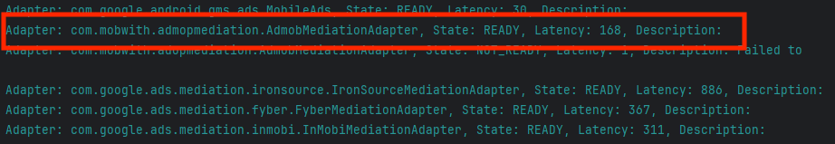
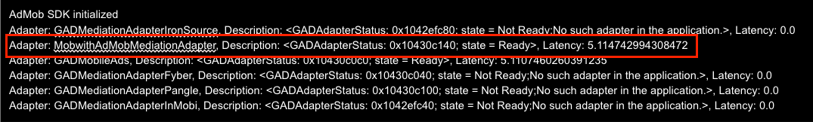

# AdMob Adapter SDK Installation <!-- {docsify-ignore} -->

This guide explains how to install the SDKs required to serve MobWith ads through AdMob mediation.<br>
You need to install both the **MobWith SDK** and the **AdMob Adapter SDK**.

!> The AdMob Adapter participates in AdMob mediation as a 3rd party, so **the AdMob SDK must be installed in your project first**.<br>
If the AdMob SDK is not installed yet, refer to the [Android](https://developers.google.com/admob/android/quick-start) / [iOS](https://developers.google.com/admob/ios/quick-start) guides to install the AdMob SDK and configure ads first.

## 1. MobWith SDK Basic Setup <!-- {docsify-ignore} -->

The AdMob Adapter serves ads through the MobWith SDK, so the basic setup of the MobWith SDK is required first.

- Android : In the SDK Installation guide, add the repositories that match the MobWith SDK version you use from [Gradle Configuration](/Android/installation?id=gradle-configuration) and apply [Permissions](/Android/installation?id=permissions).<br>For the MobWith SDK dependency, use the settings in Step 2 below instead of the version in that guide.
- iOS : Install the MobWith SDK by referring to [Install Using CocoaPods](/iOS/installation_base?id=install-using-cocoapods) in the SDK Installation guide.

?> Mediation within the MobWith SDK itself (integration with other ad networks such as AdFit and BidMad) is a separate feature from the AdMob Adapter integration. Apply it only if agreed upon, by referring to each network's SDK section in the SDK Installation guide.

## 2. Add the AdMob Adapter SDK <!-- {docsify-ignore} -->

Add the dependencies below for each platform.<br>
On Android, add the AdMob Adapter, the AdMob SDK, and the MobWith SDK together. On iOS, add only the AdMob Adapter. (On iOS, the MobWith SDK is installed in Step 1.)

<!-- tabs:start -->

#### **Android**

Add the following to the `dependencies` block of your app module's `build.gradle(.kts)` file.

```kotlin
// AdMob Mediation Adapter
implementation("io.github.mobon:MobwithAdMobMediationAdapter:1.0.0-alpha2")

// AdMob SDK
implementation("com.google.android.gms:play-services-ads:24.2.0")
implementation("com.google.android.gms:play-services-ads-identifier:17.0.0")

// MobWith SDK
implementation("io.github.mobon:mobwithSDK:1.0.80")
implementation("com.github.Dimezis:BlurView:version-3.2.0")
```

#### **iOS**

Add the following to your project's `Podfile`, then run `pod install`.

```ruby
# CocoaPods source declarations (the order matters, otherwise pods may not be fetched correctly)

# Base repo
source 'https://cdn.cocoapods.org/'

# MobWith SDK repo
source 'https://github.com/mobon/MobwithAdSpecs.git'

# AdMob Adapter SDK
pod 'MobWithAdMobMediationAdapter'
```

?> If you have already declared the CocoaPods sources while installing the MobWith SDK, you can skip them.

<!-- tabs:end -->

## 3. Verify the SDK Installation <!-- {docsify-ignore} -->

Add a log that prints the Adapter status to the completion callback of the AdMob SDK initialization code your app already calls, as shown below, to verify that the SDK has been installed correctly.

!> The mediation setup in the AdMob admin console must be completed before verifying the installation. For setup instructions, refer to [Ad Configuration](/CustomAdapter/AdMob/loadAd.md).

<!-- tabs:start -->

#### **Android**

```java
MobileAds.initialize(context, new OnInitializationCompleteListener() {
    @Override
    public void onInitializationComplete(@NonNull InitializationStatus initializationStatus) {
        Log.d("Admob", "AdMob SDK initialized");

        if (Build.VERSION.SDK_INT >= Build.VERSION_CODES.N) {
            initializationStatus.getAdapterStatusMap().forEach((s, adapterStatus) -> {
                String log = "Adapter: " + s +
                        ", State: " + adapterStatus.getInitializationState() +
                        ", Latency: " + adapterStatus.getLatency() +
                        ", Description: " + adapterStatus.getDescription();
                Log.d("Admob", log);
            });
        }
    }
});
```

Check the logs in Logcat with the `Admob` tag. If the State of `com.mobwith.admopmediation.AdmobMediationAdapter` is **READY**, the SDK has been installed correctly.



#### **iOS**

```swift
MobileAds.shared.start { [weak self] initializationStatus in
    print("AdMob SDK initialized")

    for (adapterName, status) in initializationStatus.adapterStatusesByClassName {
        print("Adapter: \(adapterName), Description: \(status.description), Latency: \(status.latency)")
    }
}
```

Check the logs in the Xcode console. If the state of `MobwithAdMobMediationAdapter` is **Ready**, the SDK has been installed correctly.



<!-- tabs:end -->

?> If the Adapter does not appear in the list or is not ready, recheck the installation in Steps 1–2 and the mediation setup in the AdMob admin console.

## Notes <!-- {docsify-ignore} -->

- The method for applying the SDK may change after the SDK is officially distributed in the future.
- The planned distribution method is Maven for Android, and CocoaPods (using a Custom Repo) or SPM (Swift Package Manager) for iOS.

---

**Next Step** : Set up mediation in the AdMob admin console in [Ad Configuration](/CustomAdapter/AdMob/loadAd.md).
