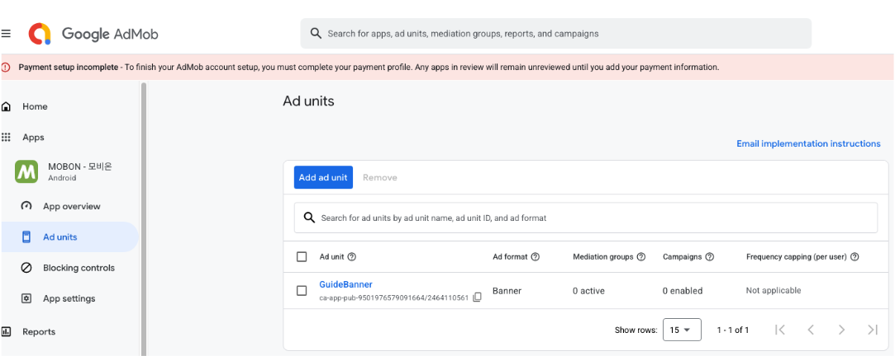
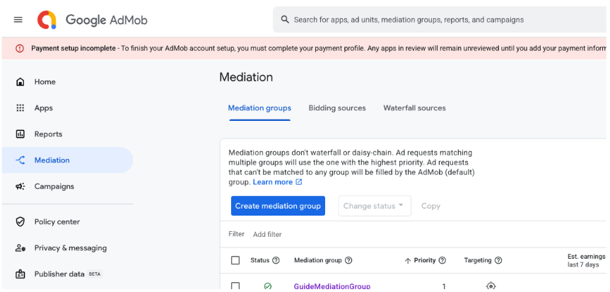
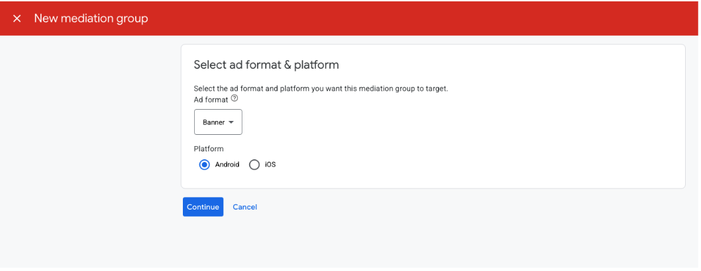
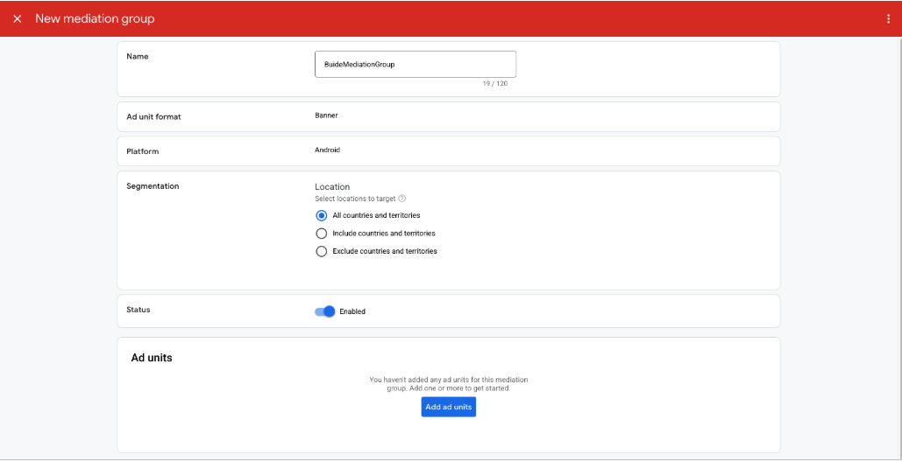
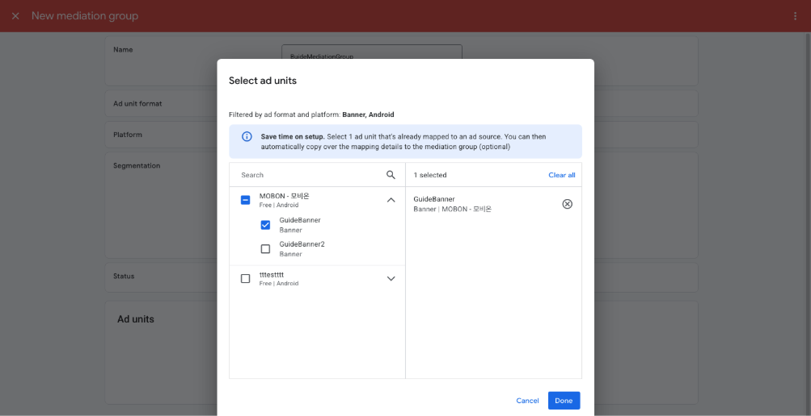
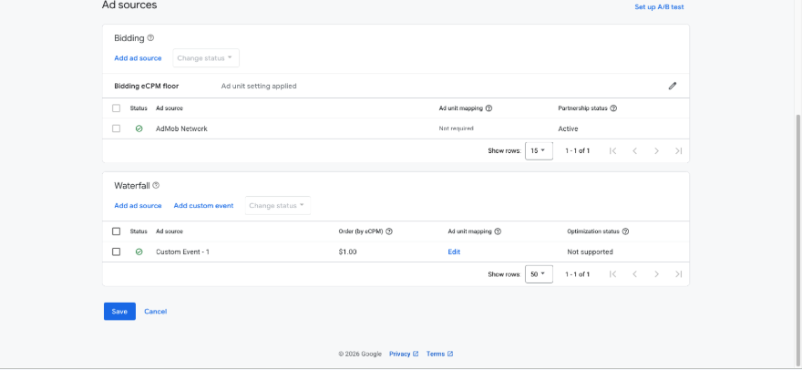

# AdMob Ad Configuration <!-- {docsify-ignore} -->

This guide explains how to set up mediation in the AdMob admin console to serve MobWith ads.

?> If you already serve ads through AdMob, you do not need to develop anything additional in your app.<br>
If AdMob ad serving is not yet applied, refer to the [Android](https://developers.google.com/admob/android/quick-start) / [iOS](https://developers.google.com/admob/ios/quick-start) AdMob guides first.

<div class="doc-flow">
  <div class="doc-flow-step"><span class="doc-flow-num">1</span><div><p class="doc-flow-title">Create an Ad Unit</p><p class="doc-flow-desc">Create the AdMob ad unit that will display MobWith ads</p></div></div>
  <div class="doc-flow-step"><span class="doc-flow-num">2</span><div><p class="doc-flow-title">Create a Waterfall Source</p><p class="doc-flow-desc">Add a MobWith Adapter mapping to the Custom Event</p></div></div>
  <div class="doc-flow-step"><span class="doc-flow-num">3</span><div><p class="doc-flow-title">Create a Mediation Group</p><p class="doc-flow-desc">Connect the MobWith source and eCPM to the ad unit</p></div></div>
</div>

The example screens are based on a banner ad in the 'MOBON - 모비온' app. Other ad types such as interstitial and reward are set up the same way, except for creating the ad unit.<br>
If you already have some settings applied, refer to the content below and apply only what you need. You can also refer to Google's [custom event setup guide](https://support.google.com/admob/answer/13407144?hl=en&ref_topic=13397014).

## 1. Create an Ad Unit <!-- {docsify-ignore} -->

In the left menu, select your app under Apps, then go to Ad units.<br>
Press **Add ad unit** and follow the guided steps to create an ad unit. Once created, it appears in the list, like 'GuideBanner' in the screenshot below.



## 2. Create a Waterfall Source <!-- {docsify-ignore} -->

#### <span class="step-label">STEP 1</span>Go to Waterfall sources

In the left menu, open the Waterfall sources tab under Mediation. The Custom Event screen appears.

#### <span class="step-label">STEP 2</span>Open the mapping input screen

Open the mapping input screen as described below, depending on whether mappings are already registered.

<!-- tabs:start -->

#### **First-time Setup**

Press **Add mapping** at the bottom of the screen.


The mapping input screen below appears.


#### **Existing Mappings**

Press **Manage mappings** on the screen.


The mapping input screen appears with your existing items.


<!-- tabs:end -->

#### <span class="step-label">STEP 3</span>Enter the mapping values

On the mapping input screen, press **Add mapping** to add another set of input fields. Enter the values by referring to the table below.

| Field | Description |
|---|---|
| **Mapping Name** | A name to identify this item in the mediation settings. Use a name that is easy to recognize. |
| **Network eCPM (optional)** | The eCPM value. It can be set separately later, so it is not required. |
| **Class Name** | The 3rd-party mediation Adapter class name. See Class Name below for the value for each platform. |
| **Parameter (optional)** | Parameters passed to the Adapter, in JSON format. It is shown as optional on the AdMob screen, but **you must enter a value that includes `unitId`** to serve MobWith ads. |

##### Class Name

<!-- tabs:start -->

#### **Android**

```text
com.mobwith.admopmediation.AdmobMediationAdapter
```

#### **iOS**

```text
MobwithAdMobMediationAdapter
```

<!-- tabs:end -->

##### Parameter

Enter JSON in the format below in the Parameter field of the mapping input screen.

| Key | Description |
|---|---|
| `unitId` | MobWith ad placement number **(required)** |
| `adSize` | The banner ad size. Choose the size that matches the ad unit from `320x50`, `320x100`, and `300x250`. |

##### Input Examples

<!-- tabs:start -->

#### **Banner**

For a 320x100 banner ad unit.

```json
{"unitId": "10892095", "adSize": "320x100"}
```

#### **Interstitial / Reward**

For interstitial and reward ads, you can use any value for `adSize`.

```json
{"unitId": "10892095", "adSize": "320x50"}
```

<!-- tabs:end -->

?> `10892095` in the examples is a sample value. For `unitId`, enter the placement number provided to you separately by your MobWith representative.<br>
Each ad unit uses a different placement number, so enter the matching placement number for each ad unit.

!> The value must be valid JSON. Wrap keys and values in double quotes ("), and separate items with commas (,).

#### <span class="step-label">STEP 4</span>Save

Once all values are entered, press **Save** and move on to the next step.

## 3. Create a Mediation Group <!-- {docsify-ignore} -->

#### <span class="step-label">STEP 1</span>Go to Mediation groups

In the left menu, open the Mediation groups tab under Mediation and press **Create mediation group**.



#### <span class="step-label">STEP 2</span>Select the ad format and platform

Select the ad format and platform to apply mediation to, then press **Continue**.



#### <span class="step-label">STEP 3</span>Enter the group name

Enter a recognizable name in Name. Ad unit format and Platform show the values you selected earlier.<br>
Press **Add ad units** in the Ad units area at the bottom.



#### <span class="step-label">STEP 4</span>Select the ad unit

In the Select ad units window, select the ad unit you created in Step 1, then press **Done**.



#### <span class="step-label">STEP 5</span>Add the waterfall source

In the Add ad source window, on the Waterfall tab, select the checkbox for the Custom Event row created in Step 2, then enter values in Label and Order (by eCPM).<br>
Once a row is selected and the values are entered, press **Add**, which becomes active.

!> The Order (by eCPM) value determines how often MobWith ads are displayed. Be sure to enter the value agreed upon with your MobWith representative.


#### <span class="step-label">STEP 6</span>Save

Review the added item, then press **Save**. Hover over the name and eCPM items to show an edit icon, which you can use to change the values.



Once saved, the Save button becomes inactive. Press the **X** at the top left to close the screen.


The setup is complete.
