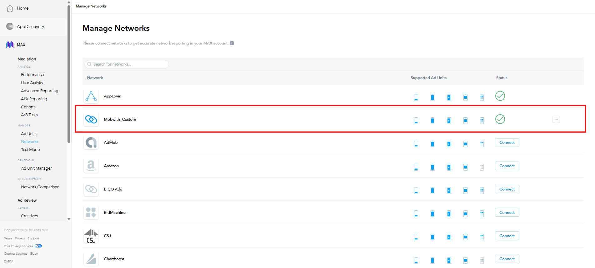
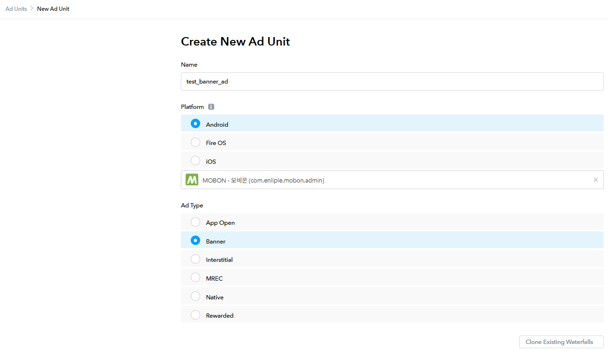

# AppLovin MAX Ad Configuration <!-- {docsify-ignore} -->

This guide explains how to set up mediation in the AppLovin MAX admin console to serve MobWith ads.

?> If you already serve ads through AppLovin MAX, you do not need to develop anything additional in your app.<br>
If AppLovin MAX ad serving is not yet applied, refer to the [Android](https://support.axon.ai/en/max/android/overview/integration) / [iOS](https://support.axon.ai/en/max/ios/overview/integration) AppLovin MAX guides first.

<div class="doc-flow">
  <div class="doc-flow-step"><span class="doc-flow-num">1</span><div><p class="doc-flow-title">Create a Custom Network</p><p class="doc-flow-desc">Register a Custom Network with the MobWith Adapter class names</p></div></div>
  <div class="doc-flow-step"><span class="doc-flow-num">2</span><div><p class="doc-flow-title">Create an Ad Unit</p><p class="doc-flow-desc">Create the AppLovin MAX ad unit that will display MobWith ads</p></div></div>
  <div class="doc-flow-step"><span class="doc-flow-num">3</span><div><p class="doc-flow-title">Configure the Custom Network</p><p class="doc-flow-desc">Connect the MobWith placement number and CPM to the ad unit</p></div></div>
</div>

The example screens are based on a banner ad in the 'MOBON - 모비온' app. Other ad types such as interstitial and reward are set up the same way, except for creating the ad unit.<br>
If you already have some settings applied, refer to the content below and apply only what you need.

## 1. Create a Custom Network <!-- {docsify-ignore} -->

To mediate the MobWith SDK in AppLovin MAX, you must first register a Custom Network.

#### <span class="step-label">STEP 1</span>Open the Custom Network screen

In the left menu, open the Networks tab under MAX > Mediation.<br>
Press **Click here to add a Custom Network** at the bottom of the screen.


#### <span class="step-label">STEP 2</span>Enter the Custom Network details

On the Manage Network screen, enter the values by referring to the table below, then press **Save**.


| Field | Description |
|---|---|
| **Custom Network Name** | A name to identify this item in the mediation ad settings. Use a name that is easy to recognize. |
| **iOS Adapter Class Name** | The iOS 3rd-party mediation Adapter class name. Enter the iOS value in Class Name below. |
| **Android / Fire OS Adapter Class Name** | The Android 3rd-party mediation Adapter class name. Enter the Android value in Class Name below. |

##### Class Name

<!-- tabs:start -->

#### **Android**

```text
com.mobwith.applovinmediation.ApplovinMediationAdapter
```

#### **iOS**

```text
MobwithAppLovinMediationAdapter
```

<!-- tabs:end -->

#### <span class="step-label">STEP 3</span>Check the registration

Once registered, the Custom Network appears in the Networks list with the name you entered.



## 2. Create an Ad Unit <!-- {docsify-ignore} -->

?> If you have already created an AppLovin MAX ad unit, go to [3. Configure the Custom Network](/CustomAdapter/Applovin/loadAd?id=_3-configure-the-custom-network).

#### <span class="step-label">STEP 1</span>Go to Ad Units

In the left menu, open the Ad Units tab under MAX > Mediation, then press **Create Ad Unit** at the top right of the screen.


#### <span class="step-label">STEP 2</span>Enter the ad unit details

Set Name, Platform, and Ad Type for the ad you want. The example is an Android banner (Banner) ad.



## 3. Configure the Custom Network <!-- {docsify-ignore} -->

This step requires the Custom Network registered in Step 1.

#### <span class="step-label">STEP 1</span>Enter the Custom Network values

In the Custom Networks area of the ad unit settings screen, configure the Custom Network registered in Step 1. Enter the values by referring to the table below.


| Field | Description |
|---|---|
| **App ID (optional)** | A unique ID assigned to the app. Use a name that is easy to recognize. |
| **Placement ID** | The placement ID. Use a name that is easy to recognize. |
| **Custom Parameters** | Parameters passed to the Adapter, in JSON format. **You must enter a value that includes `unitId`** to serve MobWith ads. |
| **CPM Price** | The ad price generated per 1,000 ad impressions. |

!> The CPM Price value determines how often MobWith ads are displayed. Be sure to enter the value agreed upon with your MobWith representative.

##### Custom Parameters

Enter JSON in the format below in the Custom Parameters field.

| Key | Description |
|---|---|
| `unitId` | MobWith ad placement number **(required)** |
| `adSize` | The banner ad size. Choose the size that matches the ad unit from `320x50`, `320x100`, and `300x250`. |

##### Input Examples

<!-- tabs:start -->

#### **Banner**

For a 320x100 banner ad unit.

```json
{"unitId": "10892095", "adSize": "320x100"}
```

#### **Interstitial / Reward**

For interstitial and reward ads, you can use any value for `adSize`.

```json
{"unitId": "10892095", "adSize": "320x50"}
```

<!-- tabs:end -->

?> `10892095` in the examples is a sample value. For `unitId`, enter the placement number provided to you separately by your MobWith representative.<br>
Each ad unit uses a different placement number, so enter the matching placement number for each ad unit.

!> The value must be valid JSON. Wrap keys and values in double quotes ("), and separate items with commas (,).

#### <span class="step-label">STEP 2</span>Check the Ad Unit ID

Once the setup is complete, an Ad Unit ID is generated as shown below.


The setup is complete.
