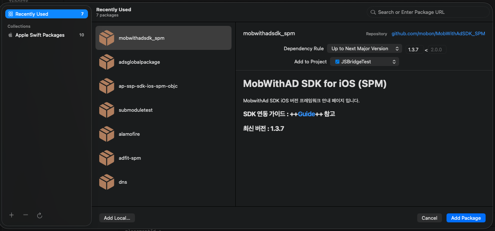
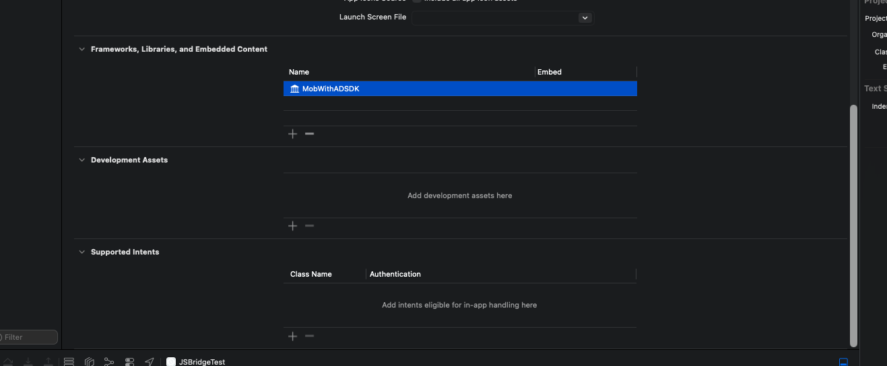

# SDK Installation <!-- {docsify-ignore} -->

This page describes how to install the MobWith SDK in your app project.<br>
Choose one of the following installation methods: SPM, CocoaPods, or manual installation.

<div class="info-card-grid">
  <div class="info-card">
    <div class="info-card-head"><p class="info-card-name">SPM</p><span class="info-card-version">Recommended</span></div>
    <dl class="info-card-meta"><dt>Base Framework</dt><dd>Supported</dd><dt>Mediation Adapters</dt><dd>AdFit supported<br>More Adapters to be added gradually</dd></dl>
    <div class="info-card-links"><a class="info-card-main" href="#/iOS/installation_base?id=install-using-swift-package-manager-spm">Install with SPM</a></div>
  </div>
  <div class="info-card">
    <div class="info-card-head"><p class="info-card-name">CocoaPods</p><span class="info-card-version deprecated">Sunsetting</span></div>
    <dl class="info-card-meta"><dt>Base Framework</dt><dd>Supported</dd><dt>Mediation Adapters</dt><dd>Supported</dd></dl>
    <div class="info-card-links"><a href="#/iOS/installation_base?id=install-using-cocoapods">Install with CocoaPods</a></div>
  </div>
  <div class="info-card">
    <div class="info-card-head"><p class="info-card-name">Manual Installation</p></div>
    <dl class="info-card-meta"><dt>Base Framework</dt><dd>Supported</dd><dt>Mediation Adapters</dt><dd>Supported</dd></dl>
    <div class="info-card-links"><a href="#/iOS/installation_base?id=manual-installation">Install manually</a></div>
  </div>
</div>

## Install Using Swift Package Manager (SPM)

You can use Swift Package Manager (SPM) to install the base framework and some mediation Adapters (AdFit).

?> Other Adapters will be added to SPM gradually. If you need an Adapter that is not yet available via SPM, please wait for SPM support, or install the SDK and Adapters with [CocoaPods](/iOS/installation_base?id=install-using-cocoapods) for the time being. If you need support urgently, please contact us.<br>
For the current support status, see [Adapter Compatibility](/iOS/adapter_compatibility.md).

Use the following Git repository URL to add the package.

```text
https://github.com/mobon/MobWithAdSDK_SPM
```

#### <span class="step-label">STEP 1</span>Add the package

In your project settings, add the package under Packages using the Git repository URL above.



#### <span class="step-label">STEP 2</span>Verify the framework in your target

Make sure that the MobWithADSDK framework has been added under Targets > Frameworks, Libraries, and Embedded Content.<br>
If it was not added automatically, click the **+** button to add the framework.



#### <span class="step-label">STEP 3</span>Add mediation Adapters

Add a package using the Git URL of the Adapter you want to use. When you add an Adapter, compatible versions of the MobWith SDK and the mediation target SDK are installed with it.

```text
# MobWithAdFitAdapter (1.0.0 or higher)
https://github.com/mobon/MobWithAdFitAdapter_iOS
```

For the MobWith SDK and mediation target SDK versions compatible with each Adapter version, see [Adapter Compatibility](/iOS/adapter_compatibility.md).

!> If the MobWithAdSDK_SPM version added to your app is outside the Adapter's supported range, the package cannot be resolved.

#### <span class="step-label">STEP 4</span>Set Other Linker Flags

**Add `-ObjC`** to Build Settings > Other Linker Flags of your app target.<br>
Without this value, the framework may not be included in the app correctly even if the build succeeds. For details, see [Other Linker Setup](/iOS/installation_other?id=other-linker-setup).

```text
-ObjC
```

## Install Using CocoaPods<span class="title-badge deprecated" data-label="Sunsetting"></span>

!> **Sunsetting** : As the official CocoaPods repository (Trunk) becomes read-only on December 2, 2026 ([CocoaPods announcement](https://blog.cocoapods.org/CocoaPods-Specs-Repo/)), we have decided to discontinue distributing the MobWith SDK via CocoaPods in the future.<br>
The base framework will continue to be distributed via CocoaPods for the time being, and mediation Adapters are gradually moving to SPM. Versions that have already been released can still be installed.<br>
We apologize for any inconvenience. For new integrations, we recommend [Install Using SPM](/iOS/installation_base?id=install-using-swift-package-manager-spm).

!> Starting from version 1.3.0, the way CocoaPods and the SDKs for mediation are applied has changed.<br>
In particular, note that the pod name has **changed from `MobWithAD` to `MobWithAdSDK`**.

#### <span class="step-label">STEP 1</span>Install MobWithAdSDK

Add `MobWithAdSDK` to your project's `Podfile`, then run `pod install`.<br>
The example below installs the SDK by specifying version 1.3.39.

```ruby
# CocoaPods source declarations (the order matters, otherwise pods may not be fetched correctly)

# Base repo
source 'https://cdn.cocoapods.org/'

# MobWithAdSDK repo
source 'https://github.com/mobon/MobwithAdSpecs.git'

# Add MobWithAdSDK
pod 'MobWithAdSDK', '1.3.39'
```

#### <span class="step-label">STEP 2</span>Add Adapter SDKs for Mediation

Add the mediation Adapters you use to your `Podfile`. You must specify the same source as MobWithAdSDK.

```ruby
# AdFit Adapter (last CocoaPods version; later versions are distributed via SPM only)
pod 'MobWithAdFitAdapter', '3.21.24.1.3.34'

# AdMob Adapter
pod 'MobWithAdMobAdapter', '13.2.0.1.3.36'
# If you are using AdMob SDK 12.6.x, use the following Adapter version.
# pod 'MobWithAdMobAdapter', '12.6.0.1.3.10'

# Cauly Adapter
pod 'MobWithCaulyAdapter', '3.1.22.1.3.1'

# DT Exchange Adapter
pod 'MobWithDTExchangeAdapter', '8.4.2.1.3.1'

# InMobi Adapter
pod 'MobWithInMobiAdapter', '11.1.0.1.3.1'

# LevelPlay Adapter
pod 'MobWithLevelPlayAdapter', '9.2.0.0.1.3.1'

# Pangle Adapter
pod 'MobWithPangleAdapter', '7.8.0.4.1.3.1'

# For BidMad, you must apply at least one of the BidMad Adapters as shown below.
# For the BidMad Adapters, refer to each SDK's guide document in the Manual Installation section.
pod 'MobWithBidMadAdapter', '6.13.6.1.3.21'
pod 'BidmadAdmixerAdapter', '2.0.2.12.2'

pod 'BidmadSDK/core', '= 6.13.6'             # Workaround for build errors

# AdPopcorn Adapter (for NAM)
pod 'MobWithAdPopcornAdapter', '3.3.2.1.3.34'
```

##### Adapter Version Rule

Adapters distributed via CocoaPods follow the version rule below. SPM Adapters use their own versioning starting from 1.0.0, so see [Adapter Compatibility](/iOS/adapter_compatibility.md).

```text
[Version of the mediation target SDK].[Version of the MobWith SDK]
```

For example, for MobWithAdFitAdapter:

```ruby
# This means it is optimized for AdFit SDK version 3.21.15 and MobWith SDK version 1.3.1.
pod 'MobWithAdFitAdapter', '3.21.15.1.3.1'
```

Each Adapter has a dependency on the SDK version it supports, so installing an Adapter automatically installs the corresponding SDK version.<br>
If you are already using a different version of the SDK, or using the same SDK through another ad SDK, a conflict may occur during pod installation or a different SDK version may be installed, which can cause errors when running the app depending on the SDK version.<br>
Therefore, we recommend matching your SDK versions and Adapter versions according to the rule above.

?> If you need support for a version of a mediation SDK that is not currently supported, please contact us separately.

##### Additional Settings per Mediation SDK

Refer to each SDK's guide document in [Manual Installation](/iOS/installation_base?id=manual-installation) below and apply the additional settings.

##### Handling Build Errors When Using BidMad

When you add BidMad's mediation Adapter, a version of the BidMad SDK different from the one added as a dependency in MobWithBidMadAdapter may be installed.<br>
To prevent this, refer to the following to pin a specific version, or align to the latest version where possible.<br>
If you cannot find a MobWithBidMadAdapter that supports the latest version of BidMad, please contact us.

```ruby
...

pod 'MobWithBidMadAdapter', '6.13.6.1.3.21'
pod 'BidmadAdmixerAdapter', '2.0.2.12.2'
...

# Add at the end of the BidMad-related pod settings; we recommend matching it to the version of the mediation target SDK
pod 'BidmadSDK/core', '= 6.13.6'
```

?> If you installed the pods before adding the content above, you must reset the pod-related content and reinstall for the change to take effect.<br>
(Delete the Pods folder, remove Podfile.lock, clear the contents of the DerivedData folder, etc.)

## Manual Installation

When installing the SDK manually, you must apply all of the items below.

!> When installing manually, you must refer to [Other Linker Setup](/iOS/installation_other?id=other-linker-setup) and **modify the Other Linker Flags value**.

#### <span class="step-label">STEP 1</span>Install the base framework

Download `MobWithADSDKFramework.xcframework.zip` for the version you want from Releases in [MobWithAdSDK_SPM](https://github.com/mobon/MobWithAdSDK_SPM), unzip it, and use the resulting `MobWithADSDKFramework.xcframework`.<br>
Drag and drop the downloaded framework onto the General > Embedded Binaries section of your app project.

?> For earlier versions that have no `.zip` file in Releases, download `MobWithADSDKFramework.xcframework` from [MobWithAdSDK_iOS](https://github.com/mobon/MobWithAdSDK_iOS).

#### <span class="step-label">STEP 2</span>Install Adapter frameworks

Download the frameworks you need from the Adapter download links below, then install the main SDK for each Adapter by referring to its SDK installation guide.<br>
The download method depends on the Adapter version.

| Type | How to Download |
|---|---|
| AdFit 1.0.0 or higher | Download the `[Adapter name].xcframework.zip` file (e.g. `MobWithAdFitAdapter.xcframework.zip`) for the version you want from Releases on the download page, unzip it, and use the resulting `.xcframework`. |
| Other Adapters | Select a version in the Tags tab of the branch selection menu on the download page, then download the `.xcframework`. |

?> All frameworks released in the future (including the base framework) will be provided as a `[framework name].xcframework.zip` file per version in Releases.

| Adapter | Adapter Download | SDK Installation Guide |
|---|---|---|
| LevelPlay | [MobWithLevelPlayAdapter_iOS](https://github.com/mobon/MobWithLevelPlayAdapter_iOS) | [LevelPlay SDK](https://docs.unity.com/en-us/grow/levelplay/sdk/ios) |
| AdFit | [MobWithAdFitAdapter_iOS](https://github.com/mobon/MobWithAdFitAdapter_iOS) | [AdFit SDK](https://adfit.github.io/adfit-ios-sdk/documentation/adfitsdk/) |
| Cauly | [MobWithCaulyAdapter_iOS](https://github.com/mobon/MobWithCaulyAdapter_iOS) | [Cauly SDK](https://cauly.gitbook.io/cauly/ios/import-sdk) |
| AdMob | [MobWithAdMobAdapter_iOS](https://github.com/mobon/MobWithAdMobAdapter_iOS) | [AdMob SDK](https://developers.google.com/admob/ios/quick-start?hl=ko) |
| ADOP BidMad | [MobWithBidMadAdapter_iOS](https://github.com/mobon/MobWithBidMadAdapter_iOS) | [BidMad SDK](https://github.com/bidmad/Bidmad-iOS?tab=readme-ov-file#bidmadsdk-installation-guide) |
| DT Exchange | [MobWithDTExchangeAdapter_iOS](https://github.com/mobon/MobWithDTExchangeAdapter_iOS) | [DT Exchange SDK](https://docs.digitalturbine.com/dt-exchange/publishers/sdk-configuration/integrating-the-ios-sdk) |
| Pangle | [MobWithPangleAdapter_iOS](https://github.com/mobon/MobWithPangleAdapter_iOS) | [Pangle SDK](https://www.pangleglobal.com/integration/integrate-pangle-sdk-for-ios) |
| InMobi | [MobWithInMobiAdapter_iOS](https://github.com/mobon/MobWithInMobiAdapter_iOS) | [InMobi SDK](https://support.inmobi.com/monetize/sdk-documentation/ios-guidelines/overview-ios-guidelines#option-1--integration-via-cocoapods) |

?> For Cauly and AdFit (3.21.24.1.3.34 or lower), you can also download the SDK matching each version from the Adapter download page. For AdFit 1.0.0 or higher, install the AdFit SDK by referring to its SDK installation guide.

---

**Next Step** : Configure your project in [Project Configuration](/iOS/installation_other.md).
