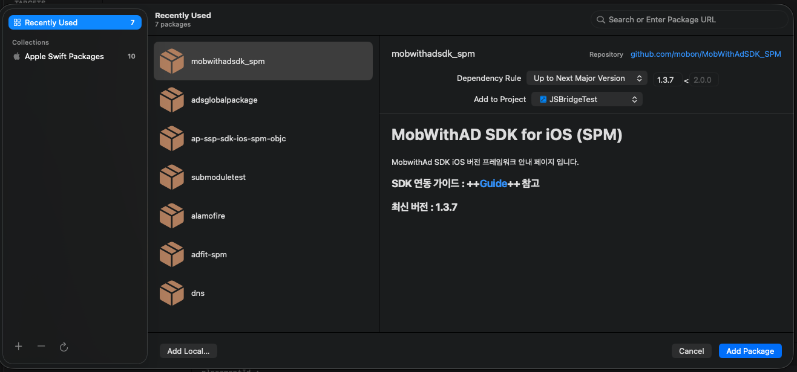
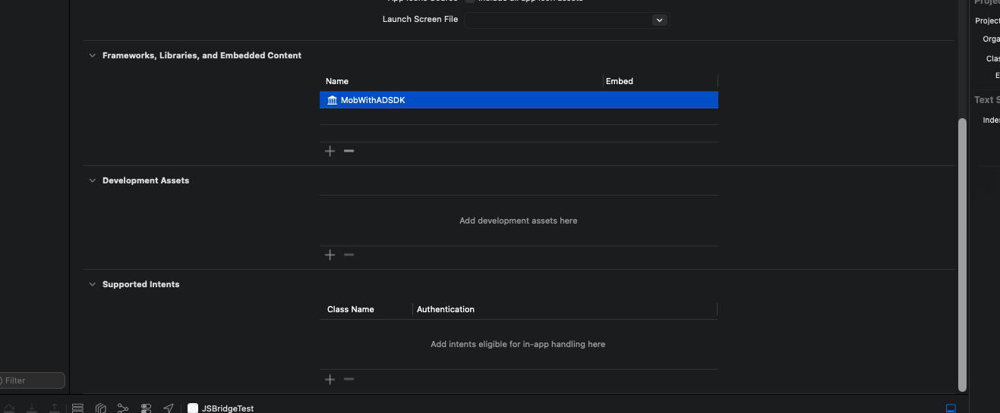

# SDK Installation <!-- {docsify-ignore} -->

This page describes how to install the MobWith SDK in your app project.<br>
Choose one of the following installation methods: SPM, CocoaPods, or manual installation.

| Installation Method | Base Framework | Mediation Adapters |
|---|---|---|
| SPM | Supported | Not supported (add them via manual installation) |
| CocoaPods | Supported | Supported |
| Manual Installation | Supported | Supported |

## Install Using Swift Package Manager (SPM) <!-- {docsify-ignore} -->

Swift Package Manager (SPM) currently supports installation of the base framework only.

?> If you install the SDK using SPM, install each mediation Adapter manually by referring to Installing Adapter Frameworks in [Manual Installation](/iOS/installation_base?id=manual-installation) below.

Use the following Git repository URL to add the package.

```text
https://github.com/mobon/MobWithAdSDK_SPM
```

#### <span class="step-label">STEP 1</span>Add the package

In your project settings, add the package under Packages using the Git repository URL above.



#### <span class="step-label">STEP 2</span>Verify the framework in your target

Make sure that the MobWithADSDK framework has been added under Targets > Frameworks, Libraries, and Embedded Content.<br>
If it was not added automatically, click the **+** button to add the framework.



## Install Using CocoaPods <!-- {docsify-ignore} -->

!> Starting from version 1.3.0, the way CocoaPods and the SDKs for mediation are applied has changed.<br>
In particular, note that the pod name has **changed from `MobWithAD` to `MobWithAdSDK`**.

#### <span class="step-label">STEP 1</span>Install MobWithAdSDK

Add `MobWithAdSDK` to your project's `Podfile`, then run `pod install`.<br>
The example below installs the SDK by specifying version 1.3.35.

```ruby
# CocoaPods source declarations (the order matters, otherwise pods may not be fetched correctly)

# Base repo
source 'https://cdn.cocoapods.org/'

# MobWithAdSDK repo
source 'https://github.com/mobon/MobwithAdSpecs.git'

# Add MobWithAdSDK
pod 'MobWithAdSDK', '1.3.35'
```

#### <span class="step-label">STEP 2</span>Add Adapter SDKs for Mediation

Add the mediation Adapters you use to your `Podfile`. You must specify the same source as MobWithAdSDK.

```ruby
# AdFit Adapter
pod 'MobWithAdFitAdapter', '3.21.24.1.3.34'

# AdMob Adapter
pod 'MobWithAdMobAdapter', '12.14.0.1.3.21'
# If you are using AdMob SDK 12.6.x, use the following Adapter version.
# pod 'MobWithAdMobAdapter', '12.6.0.1.3.10'

# Cauly Adapter
pod 'MobWithCaulyAdapter', '3.1.22.1.3.1'

# DT Exchange Adapter
pod 'MobWithDTExchangeAdapter', '8.4.2.1.3.1'

# InMobi Adapter
pod 'MobWithInMobiAdapter', '11.1.0.1.3.1'

# LevelPlay Adapter
pod 'MobWithLevelPlayAdapter', '9.2.0.0.1.3.1'

# Pangle Adapter
pod 'MobWithPangleAdapter', '7.8.0.4.1.3.1'

# For BidMad, you must apply at least one of the BidMad Adapters as shown below.
# For the BidMad Adapters, refer to each SDK's guide document in the Manual Installation section.
pod 'MobWithBidMadAdapter', '6.13.6.1.3.21'
pod 'BidmadAdmixerAdapter', '2.0.2.12.2'

pod 'BidmadSDK/core', '= 6.13.6'             # Workaround for build errors

# AdPopcorn Adapter (for NAM)
pod 'MobWithAdPopcornAdapter', '3.3.2.1.3.34'
```

##### Adapter Version Rule

Adapter versions follow the rule below.

```text
[Version of the mediation target SDK].[Version of the MobWith SDK]
```

For example, for MobWithAdFitAdapter:

```ruby
# This means it is optimized for AdFit SDK version 3.21.15 and MobWith SDK version 1.3.1.
pod 'MobWithAdFitAdapter', '3.21.15.1.3.1'
```

Each Adapter has a dependency on the SDK version it supports, so installing an Adapter automatically installs the corresponding SDK version.<br>
If you are already using a different version of the SDK, or using the same SDK through another ad SDK, a conflict may occur during pod installation or a different SDK version may be installed, which can cause errors when running the app depending on the SDK version.<br>
Therefore, we recommend matching your SDK versions and Adapter versions according to the rule above.

?> If you need support for a version of a mediation SDK that is not currently supported, please contact us separately.

##### Additional Settings per Mediation SDK

Refer to each SDK's guide document in [Manual Installation](/iOS/installation_base?id=manual-installation) below and apply the additional settings.

##### Handling Build Errors When Using BidMad

When you add BidMad's mediation Adapter, a version of the BidMad SDK different from the one added as a dependency in MobWithBidMadAdapter may be installed.<br>
To prevent this, refer to the following to pin a specific version, or align to the latest version where possible.<br>
If you cannot find a MobWithBidMadAdapter that supports the latest version of BidMad, please contact us.

```ruby
...

pod 'MobWithBidMadAdapter', '6.13.6.1.3.21'
pod 'BidmadAdmixerAdapter', '2.0.2.12.2'
...

# Add at the end of the BidMad-related pod settings; we recommend matching it to the version of the mediation target SDK
pod 'BidmadSDK/core', '= 6.13.6'
```

?> If you installed the pods before adding the content above, you must reset the pod-related content and reinstall for the change to take effect.<br>
(Delete the Pods folder, remove Podfile.lock, clear the contents of the DerivedData folder, etc.)

## Manual Installation <!-- {docsify-ignore} -->

When installing the SDK manually, you must apply all of the items below.

!> When installing manually, you must refer to [Other Linker Setup](/iOS/installation_other?id=other-linker-setup) and **modify the Other Linker Flags value**.

#### <span class="step-label">STEP 1</span>Install the base framework

Download `MobWithADSDKFramework.xcframework` from [MobWithAdSDK_iOS](https://github.com/mobon/MobWithAdSDK_iOS).<br>
Drag and drop the downloaded framework onto the General > Embedded Binaries section of your app project.

#### <span class="step-label">STEP 2</span>Install Adapter frameworks

Download the frameworks you need from the Adapter download links below, then install the main SDK for each Adapter by referring to its SDK installation guide.<br>
To choose a version, refer to the Tags tab in the branch selection menu of the download page.

| Adapter | Adapter Download | SDK Installation Guide |
|---|---|---|
| LevelPlay | [MobWithLevelPlayAdapter_iOS](https://github.com/mobon/MobWithLevelPlayAdapter_iOS) | [LevelPlay SDK](https://docs.unity.com/en-us/grow/levelplay/sdk/ios) |
| AdFit | [MobWithAdFitAdapter_iOS](https://github.com/mobon/MobWithAdFitAdapter_iOS) | [AdFit SDK](https://adfit.github.io/adfit-ios-sdk/documentation/adfitsdk/) |
| Cauly | [MobWithCaulyAdapter_iOS](https://github.com/mobon/MobWithCaulyAdapter_iOS) | [Cauly SDK](https://cauly.gitbook.io/cauly/ios/import-sdk) |
| AdMob | [MobWithAdMobAdapter_iOS](https://github.com/mobon/MobWithAdMobAdapter_iOS) | [AdMob SDK](https://developers.google.com/admob/ios/quick-start?hl=ko) |
| ADOP BidMad | [MobWithBidMadAdapter_iOS](https://github.com/mobon/MobWithBidMadAdapter_iOS) | [BidMad SDK](https://github.com/bidmad/Bidmad-iOS?tab=readme-ov-file#bidmadsdk-installation-guide) |
| DT Exchange | [MobWithDTExchangeAdapter_iOS](https://github.com/mobon/MobWithDTExchangeAdapter_iOS) | [DT Exchange SDK](https://docs.digitalturbine.com/dt-exchange/publishers/sdk-configuration/integrating-the-ios-sdk) |
| Pangle | [MobWithPangleAdapter_iOS](https://github.com/mobon/MobWithPangleAdapter_iOS) | [Pangle SDK](https://www.pangleglobal.com/integration/integrate-pangle-sdk-for-ios) |
| InMobi | [MobWithInMobiAdapter_iOS](https://github.com/mobon/MobWithInMobiAdapter_iOS) | [InMobi SDK](https://support.inmobi.com/monetize/sdk-documentation/ios-guidelines/overview-ios-guidelines#option-1--integration-via-cocoapods) |

?> For AdFit and Cauly, you can also download the SDK matching each version from the Adapter download page.

---

**Next Step** : Configure your project in [Project Configuration](/iOS/installation_other.md).
