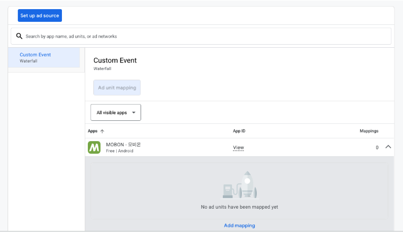
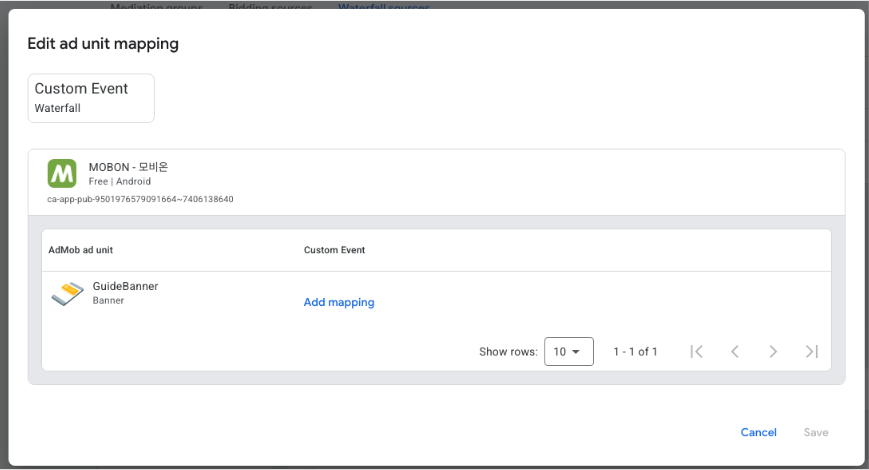
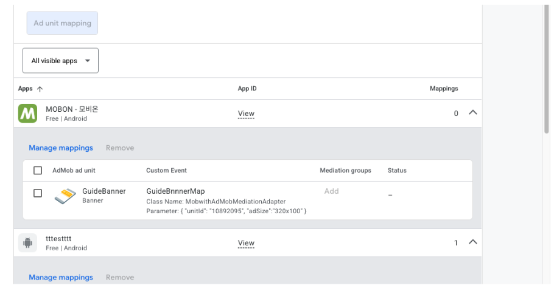
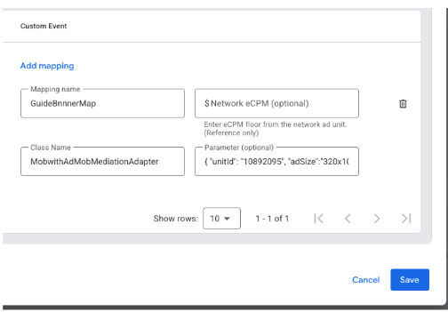
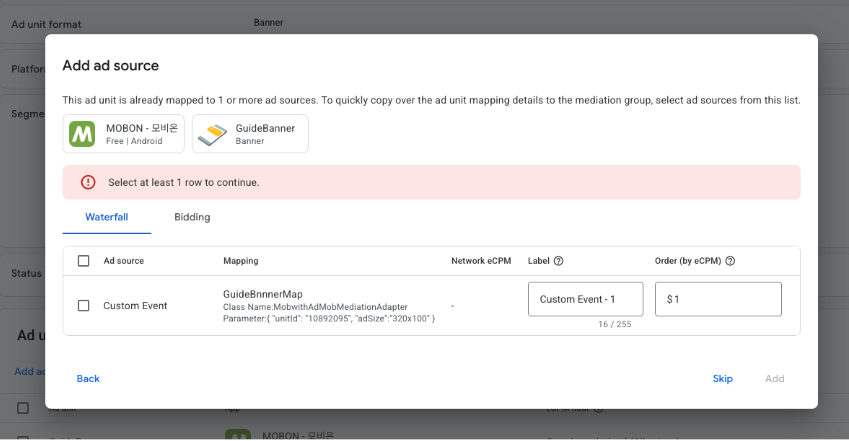
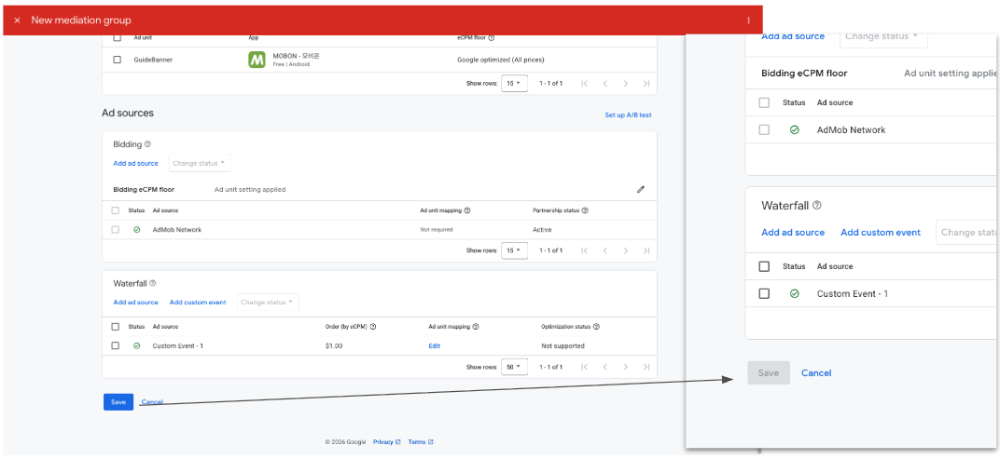

# AdMob 광고 설정 <!-- {docsify-ignore} -->

AdMob 관리자 콘솔에서 MobWith 광고를 송출하기 위한 미디에이션 설정 방법을 안내합니다.

?> 이미 AdMob으로 광고를 송출하고 있다면, 앱에서 추가로 개발할 내용은 없습니다.<br>
AdMob 광고 송출이 적용되어 있지 않다면 [Android](https://developers.google.com/admob/android/quick-start) / [iOS](https://developers.google.com/admob/ios/quick-start) AdMob 가이드를 먼저 참고해 주세요.

<div class="doc-flow">
  <div class="doc-flow-step"><span class="doc-flow-num">1</span><div><p class="doc-flow-title">광고 유닛 생성</p><p class="doc-flow-desc">MobWith 광고를 노출할 AdMob 광고 유닛 생성</p></div></div>
  <div class="doc-flow-step"><span class="doc-flow-num">2</span><div><p class="doc-flow-title">Waterfall Source 생성</p><p class="doc-flow-desc">Custom Event에 MobWith Adapter 매핑 추가</p></div></div>
  <div class="doc-flow-step"><span class="doc-flow-num">3</span><div><p class="doc-flow-title">Mediation Group 생성</p><p class="doc-flow-desc">광고 유닛에 MobWith 소스와 eCPM 연결</p></div></div>
</div>

예시 화면은 'MOBON - 모비온' 앱의 배너 광고 기준입니다. 전면, 리워드 등 다른 광고 유형도 광고 유닛 생성을 제외하면 같은 방식으로 설정합니다.<br>
이미 적용된 설정이 있다면 아래 내용을 참고하여 필요한 부분만 적용하시면 됩니다. Google의 [맞춤 이벤트 설정 가이드](https://support.google.com/admob/answer/13407144?hl=ko&ref_topic=13397014)도 함께 참고하실 수 있습니다.

## 1. 광고 유닛 생성 <!-- {docsify-ignore} -->

좌측 메뉴 Apps에서 앱을 선택한 뒤 Ad units로 이동합니다.<br>
**Add ad unit**을 눌러 안내에 따라 광고 유닛을 생성합니다. 생성이 완료되면 아래 스크린샷의 'GuideBanner'처럼 목록에 표시됩니다.


## 2. Waterfall Source 생성 <!-- {docsify-ignore} -->

#### <span class="step-label">STEP 1</span>Waterfall sources로 이동

좌측 메뉴 Mediation에서 Waterfall sources 탭을 열면 Custom Event 화면이 표시됩니다.

#### <span class="step-label">STEP 2</span>매핑 입력 화면 열기

등록된 매핑이 있는지에 따라 아래를 참고하여 매핑 입력 화면을 엽니다.

<!-- tabs:start -->

#### **처음 등록하는 경우**

화면 하단의 **Add mapping**을 누릅니다.



아래와 같은 매핑 입력 화면이 표시됩니다.



#### **기존 매핑이 있는 경우**

화면에 표시된 **Manage mappings**를 누릅니다.



기존에 등록한 항목이 함께 표시된 매핑 입력 화면이 나타납니다.



<!-- tabs:end -->

#### <span class="step-label">STEP 3</span>매핑 값 입력

매핑 입력 화면에서 **Add mapping**을 누르면 입력 항목이 한 세트 추가됩니다. 아래를 참고하여 값을 입력합니다.

| 필드 | 설명 |
|---|---|
| **Mapping Name** | 미디에이션 설정에서 항목을 구분하기 위한 이름입니다. 식별하기 쉬운 이름을 사용하세요. |
| **Network eCPM (optional)** | eCPM 값입니다. 나중에 따로 설정할 수 있어 필수 입력은 아닙니다. |
| **Class Name** | 3rd-party 미디에이션 Adapter 클래스명입니다. 플랫폼별 값은 아래 Class Name을 참고하세요. |
| **Parameter (optional)** | Adapter로 전달되는 파라미터로, JSON 형식을 사용합니다. AdMob 화면에는 선택 항목으로 표시되지만, MobWith 광고 송출을 위해 **`unitId`가 포함된 값을 반드시 입력**해야 합니다. |

##### Class Name

<!-- tabs:start -->

#### **Android**

```text
com.mobwith.admopmediation.AdmobMediationAdapter
```

#### **iOS**

```text
MobwithAdMobMediationAdapter
```

<!-- tabs:end -->

##### Parameter

매핑 입력 화면의 Parameter 필드에 아래 형식의 JSON을 입력합니다.

| Key | 설명 |
|---|---|
| `unitId` | MobWith 광고 지면 번호 **(필수)** |
| `adSize` | 배너 광고 크기입니다. `320x50`, `320x100`, `300x250` 중 광고 유닛에 맞는 크기를 선택합니다. |

##### 입력 예시

<!-- tabs:start -->

#### **배너**

320x100 크기의 배너 광고 유닛에 설정하는 경우입니다.

```json
{"unitId": "10892095", "adSize": "320x100"}
```

#### **전면 / 리워드**

전면, 리워드 광고는 `adSize`에 임의 값을 사용할 수 있습니다.

```json
{"unitId": "10892095", "adSize": "320x50"}
```

<!-- tabs:end -->

?> 예시의 `10892095`는 샘플 값입니다. `unitId`에는 MobWith 담당자에게 별도로 안내받은 지면 번호를 입력해 주세요.<br>
광고 유닛마다 서로 다른 지면 번호를 사용하므로, 각 광고 유닛에 맞는 지면 번호를 각각 입력해야 합니다.

!> JSON 형식에 맞게 입력해야 합니다. Key와 값은 큰따옴표(")로 감싸고, 항목 사이는 쉼표(,)로 구분합니다.

#### <span class="step-label">STEP 4</span>저장

값을 모두 입력한 뒤 **Save**를 눌러 저장하고 다음 단계로 넘어갑니다.

## 3. Mediation Group 생성 <!-- {docsify-ignore} -->

#### <span class="step-label">STEP 1</span>Mediation groups로 이동

좌측 메뉴 Mediation에서 Mediation groups 탭을 열고 **Create mediation group**을 누릅니다.


#### <span class="step-label">STEP 2</span>광고 유형과 플랫폼 선택

미디에이션을 적용할 광고 유형과 플랫폼을 선택한 뒤 **Continue**를 누릅니다.


#### <span class="step-label">STEP 3</span>그룹 이름 입력

Name에 알아보기 쉬운 이름을 입력합니다. Ad unit format과 Platform에는 앞에서 선택한 값이 표시됩니다.<br>
하단 Ad units 영역의 **Add ad units**를 누릅니다.


#### <span class="step-label">STEP 4</span>광고 유닛 선택

Select ad units 창에서 1단계에서 만든 광고 유닛을 선택한 뒤 **Done**을 누릅니다.


#### <span class="step-label">STEP 5</span>Waterfall source 추가

Add ad source 창의 Waterfall 탭에서 2단계에서 만든 Custom Event 행의 체크박스를 선택하고, Label과 Order (by eCPM)에 값을 입력합니다.<br>
행을 선택하고 값을 입력하면 활성화되는 **Add**를 누릅니다.

!> Order (by eCPM) 값에 따라 MobWith 광고의 노출 빈도가 결정됩니다. 반드시 MobWith 담당자와 협의된 값을 입력해 주세요.



#### <span class="step-label">STEP 6</span>저장

추가된 항목을 확인한 뒤 **Save**를 누릅니다. 이름과 eCPM 항목에 마우스를 올리면 나타나는 편집 아이콘으로 값을 수정할 수 있습니다.


저장이 완료되면 Save 버튼이 비활성화됩니다. 좌측 상단의 **X**를 눌러 화면을 닫습니다.



설정이 완료되었습니다.
