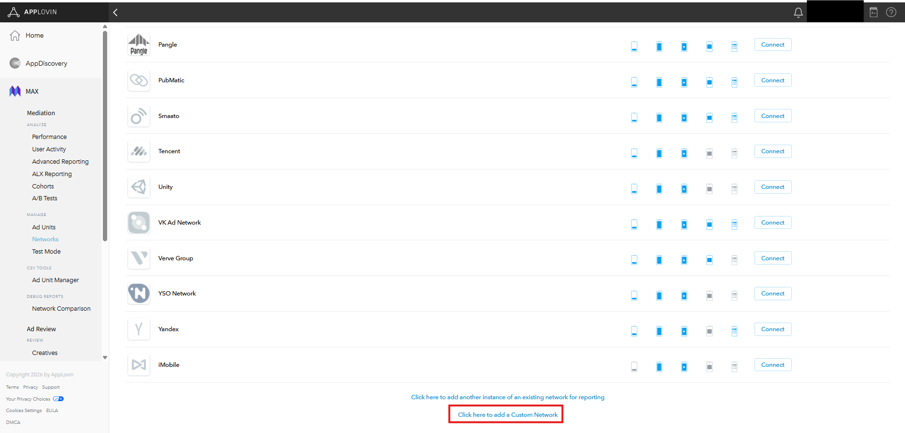
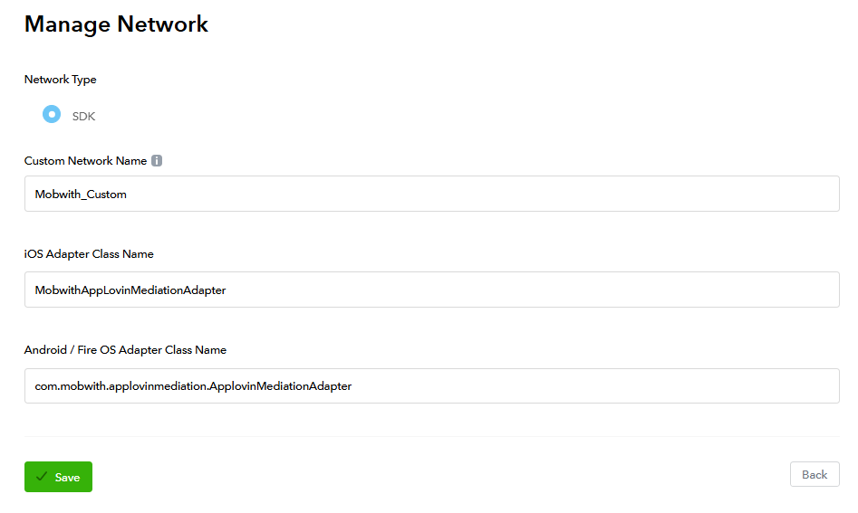
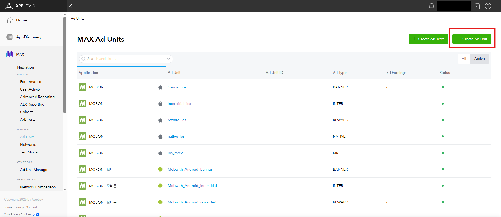
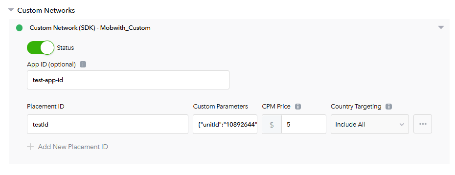
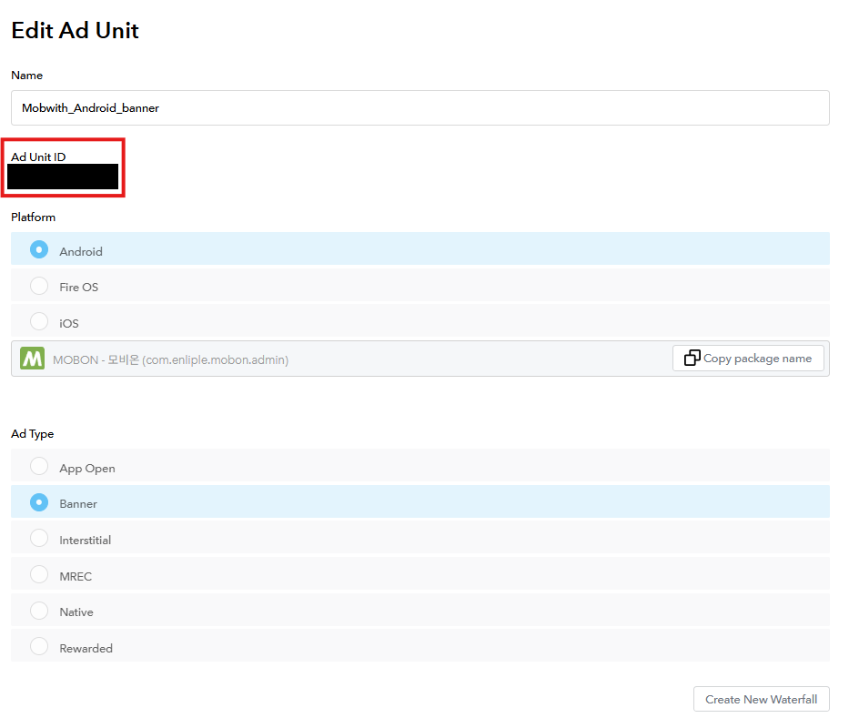

# AppLovin MAX 광고 설정 <!-- {docsify-ignore} -->

AppLovin MAX 관리자 콘솔에서 MobWith 광고를 송출하기 위한 미디에이션 설정 방법을 안내합니다.

?> 이미 AppLovin MAX로 광고를 송출하고 있다면, 앱에서 추가로 개발할 내용은 없습니다.<br>
AppLovin MAX 광고 송출이 적용되어 있지 않다면 [Android](https://support.axon.ai/en/max/android/overview/integration) / [iOS](https://support.axon.ai/en/max/ios/overview/integration) AppLovin MAX 가이드를 먼저 참고해 주세요.

<div class="doc-flow">
  <div class="doc-flow-step"><span class="doc-flow-num">1</span><div><p class="doc-flow-title">Custom Network 생성</p><p class="doc-flow-desc">MobWith Adapter 클래스명으로 Custom Network 등록</p></div></div>
  <div class="doc-flow-step"><span class="doc-flow-num">2</span><div><p class="doc-flow-title">광고 유닛 생성</p><p class="doc-flow-desc">MobWith 광고를 노출할 AppLovin MAX 광고 유닛 생성</p></div></div>
  <div class="doc-flow-step"><span class="doc-flow-num">3</span><div><p class="doc-flow-title">Custom Network 설정</p><p class="doc-flow-desc">광고 유닛에 MobWith 지면 번호와 CPM 연결</p></div></div>
</div>

예시 화면은 'MOBON - 모비온' 앱의 배너 광고 기준입니다. 전면, 리워드 등 다른 광고 유형도 광고 유닛 생성을 제외하면 같은 방식으로 설정합니다.<br>
이미 적용된 설정이 있다면 아래 내용을 참고하여 필요한 부분만 적용하시면 됩니다.

## 1. Custom Network 생성 <!-- {docsify-ignore} -->

AppLovin MAX에서 MobWith SDK를 미디에이션하려면 Custom Network를 먼저 등록해야 합니다.

#### <span class="step-label">STEP 1</span>Custom Network 추가 화면 열기

좌측 메뉴 MAX > Mediation에서 Networks 탭을 엽니다.<br>
화면 맨 아래의 **Click here to add a Custom Network**를 누릅니다.



#### <span class="step-label">STEP 2</span>Custom Network 정보 입력

Manage Network 화면에서 아래를 참고하여 값을 입력한 뒤 **Save**를 누릅니다.



| 필드 | 설명 |
|---|---|
| **Custom Network Name** | 미디에이션 광고 설정에서 항목을 구분하기 위한 이름입니다. 식별하기 쉬운 이름을 사용하세요. |
| **iOS Adapter Class Name** | iOS 3rd-party 미디에이션 Adapter 클래스명입니다. 아래 Class Name의 iOS 값을 입력합니다. |
| **Android / Fire OS Adapter Class Name** | Android 3rd-party 미디에이션 Adapter 클래스명입니다. 아래 Class Name의 Android 값을 입력합니다. |

##### Class Name

<!-- tabs:start -->

#### **Android**

```text
com.mobwith.applovinmediation.ApplovinMediationAdapter
```

#### **iOS**

```text
MobwithAppLovinMediationAdapter
```

<!-- tabs:end -->

#### <span class="step-label">STEP 3</span>등록 확인

등록이 완료되면 Networks 목록에 입력한 이름의 Custom Network가 표시됩니다.


## 2. 광고 유닛 생성 <!-- {docsify-ignore} -->

?> 이미 AppLovin MAX 광고 유닛을 만들었다면 [3. Custom Network 설정](/CustomAdapter/Applovin/loadAd?id=_3-custom-network-설정)으로 이동합니다.

#### <span class="step-label">STEP 1</span>Ad Units로 이동

좌측 메뉴 MAX > Mediation에서 Ad Units 탭을 열고, 화면 우측 상단의 **Create Ad Unit**을 누릅니다.



#### <span class="step-label">STEP 2</span>광고 유닛 정보 입력

Name, Platform, Ad Type을 원하는 광고에 맞게 설정합니다. 예시는 Android 배너(Banner) 광고입니다.


## 3. Custom Network 설정 <!-- {docsify-ignore} -->

1단계에서 등록한 Custom Network가 있어야 진행할 수 있습니다.

#### <span class="step-label">STEP 1</span>Custom Network 값 입력

광고 유닛 설정 화면의 Custom Networks 영역에서 1단계에서 등록한 Custom Network를 설정합니다. 아래를 참고하여 값을 입력합니다.



| 필드 | 설명 |
|---|---|
| **App ID (optional)** | 앱에 할당된 고유 ID 값입니다. 식별하기 쉬운 이름을 사용하세요. |
| **Placement ID** | 게재위치 ID입니다. 식별하기 쉬운 이름을 사용하세요. |
| **Custom Parameters** | Adapter로 전달되는 파라미터로, JSON 형식을 사용합니다. MobWith 광고 송출을 위해 **`unitId`가 포함된 값을 반드시 입력**해야 합니다. |
| **CPM Price** | 광고가 1,000회 노출될 때 발생하는 광고 단가입니다. |

!> CPM Price 값에 따라 MobWith 광고의 노출 빈도가 결정됩니다. 반드시 MobWith 담당자와 협의된 값을 입력해 주세요.

##### Custom Parameters

Custom Parameters 필드에 아래 형식의 JSON을 입력합니다.

| Key | 설명 |
|---|---|
| `unitId` | MobWith 광고 지면 번호 **(필수)** |
| `adSize` | 배너 광고 크기입니다. `320x50`, `320x100`, `300x250` 중 광고 유닛에 맞는 크기를 선택합니다. |

##### 입력 예시

<!-- tabs:start -->

#### **배너**

320x100 크기의 배너 광고 유닛에 설정하는 경우입니다.

```json
{"unitId": "10892095", "adSize": "320x100"}
```

#### **전면 / 리워드**

전면, 리워드 광고는 `adSize`에 임의 값을 사용할 수 있습니다.

```json
{"unitId": "10892095", "adSize": "320x50"}
```

<!-- tabs:end -->

?> 예시의 `10892095`는 샘플 값입니다. `unitId`에는 MobWith 담당자에게 별도로 안내받은 지면 번호를 입력해 주세요.<br>
광고 유닛마다 서로 다른 지면 번호를 사용하므로, 각 광고 유닛에 맞는 지면 번호를 각각 입력해야 합니다.

!> JSON 형식에 맞게 입력해야 합니다. Key와 값은 큰따옴표(")로 감싸고, 항목 사이는 쉼표(,)로 구분합니다.

#### <span class="step-label">STEP 2</span>Ad Unit ID 확인

설정이 완료되면 아래와 같이 Ad Unit ID가 생성됩니다.



설정이 완료되었습니다.
