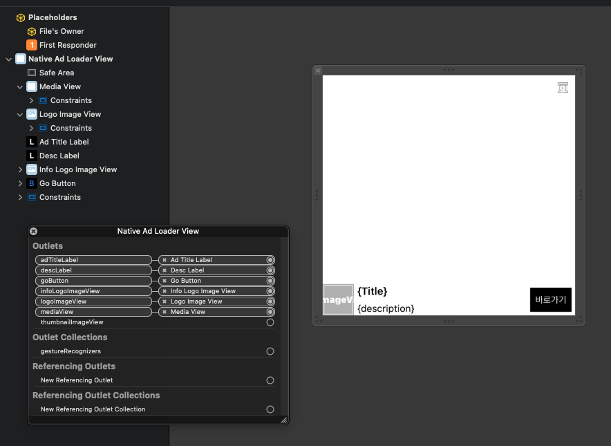

# Native AD <!-- {docsify-ignore} -->

앱에서 직접 구성한 UI에 광고 데이터를 표시하는 네이티브 광고의 사용 방법을 안내합니다.<br>
단일 지면에는 MMNativeAdView를, 리스트 형태의 화면에는 MobWithNativeAdLoader를 사용합니다.

## MMNativeAdView

사용자가 직접 뷰를 구성하면, SDK는 전달받은 각 뷰에 광고 데이터를 설정하는 기능만 담당하는 AdView입니다.

!> SDK가 설정된 View를 확인하지 못하는 경우 광고가 제대로 표시되지 않을 수 있으니 주의 바랍니다.

### 방법 1. XIB + MobwithNativeAdViewRender (권장)

?> SDK 1.3.10 이상에서 지원합니다.

기본 UI와 모비위드 직광고 전용 UI 추가 등의 기능을 지원하는 방식입니다.<br>
광고 지면을 할당하고 별도의 Interface Builder(XIB) 파일을 제공하여 광고 UI를 구성합니다.

#### <span class="step-label">STEP 1</span>XIB로 광고 UI 구성

아래 이미지를 참고하여 광고 UI를 구성합니다. 구성 예시이며, 사용하는 외부 미디에이션 SDK의 가이드를 참고하여 적절히 구성하시면 됩니다.



!> MobWithAdPopcornAdapter를 이용하여 NAM 광고를 송출하는 경우 **ContainerView의 크기를 명확하게 지정**해 주셔야 합니다.<br>
Auto Layout 등으로 내부 콘텐츠 크기에 의존하는 경우 광고가 제대로 표시되지 않을 수 있습니다.

#### <span class="step-label">STEP 2</span>MobwithNativeAdViewRender 연결

`MobwithNativeAdViewRender`를 구현하여 각 View를 연결합니다.

```swift
class DefaultNativeAdView: UIView {
    @IBOutlet weak var mediaView: UIView!
    @IBOutlet weak var adTitleLabel: UILabel!
    @IBOutlet weak var descLabel: UILabel!
    @IBOutlet weak var goButton: UIButton!
    @IBOutlet weak var logoImageView: UIImageView!
    @IBOutlet weak var infoLogoImageView: UIImageView!
}

extension DefaultNativeAdView: MobwithNativeAdViewRender {

    func getMediaView() -> UIView? {
        return mediaView
    }

    func getAdTitleLabel() -> UILabel? {
        return adTitleLabel
    }

    func getAdDescriptionLabel() -> UILabel? {
        return descLabel
    }

    func getGoToSiteButton() -> UIButton? {
        return goButton
    }

    func getAdLogoImageView() -> UIImageView? {
        return logoImageView
    }

    func getInfoLogoImageView() -> UIImageView? {
        return infoLogoImageView
    }
}
```

| 함수 | 설명 |
|---|---|
| `getMediaView() -> UIView?` | 광고 콘텐츠(이미지, 영상 등)를 표시하기 위한 View를 연결합니다. **(필수)** |
| `getAdImageView() -> UIImageView?` | 광고 이미지를 표시하기 위한 ImageView를 연결합니다. 이미지 광고 콘텐츠를 직접 지정해야 하는 경우가 아니라면 `getMediaView()` 사용을 권장합니다. |
| `getAdLogoImageView() -> UIImageView?` | 광고주 로고 이미지를 표시하기 위한 ImageView를 연결합니다. |
| `getAdTitleLabel() -> UILabel?` | 광고 메인 타이틀을 표시하기 위한 Label을 연결합니다. |
| `getAdDescriptionLabel() -> UILabel?` | 광고 설명을 표시하기 위한 Label을 연결합니다. |
| `getGoToSiteButton() -> UIButton?` | 광고 랜딩을 위한 Button을 연결합니다. CTA 타이틀이 노출되는 위치이며, 광고 유형 및 상황에 따라 해당 버튼이 직접 사용되지 않는 경우도 있습니다. |
| `getInfoLogoImageView() -> UIImageView?` | 광고 Info 이미지를 표시하기 위한 ImageView를 연결합니다. **(필수)** |

#### <span class="step-label">STEP 3</span>MMNativeAdView 생성 및 광고 로드

```swift
var nativeAdView = MMNativeAdView(bannerUnitId: defaultMediaCode,
                                  adContainerView: adContainerView,
                                  nibNameForDefault: "DefaultNativeAdView",
                                  nibNameForDirectAd: "DirectNativeAdView",
                                  bundle: Bundle.main)
nativeAdView.adDelegate = self
nativeAdView.rootViewController = self        // 미디에이션 적용된 일부 광고 SDK의 경우 rootViewController를 설정하지 않으면 광고가 표시되지 않을 수 있습니다.

nativeAdView.loadAd()
```

| 파라미터 | 설명 |
|---|---|
| `bannerUnitId` | 발급받은 광고 지면 ID를 설정합니다. |
| `adContainerView` | 광고 View를 표시할 RootView입니다. |
| `nibNameForDefault` | 광고를 표시하기 위한 UI가 설정된 xib 파일명을 전달합니다. |
| `nibNameForDirectAd` | 모비위드 직광고 전용 xib 파일명을 설정합니다. 기본 UI를 공통으로 사용하려는 경우 설정하지 않거나 빈 값으로 지정합니다. |
| `bundle` | xib 파일을 불러오기 위한 bundle을 전달합니다. `nil`로 설정하면 `Bundle.main`을 사용합니다. |

!> `nibNameForDefault`와 `nibNameForDirectAd`로 UI를 불러오지 못하는 경우 무조건 광고 없음('No Fill') 상태를 반환합니다.

### 방법 2. 고정 UI 전달 방식

?> 신규 연동 시에는 [방법 1](/iOS/nativeAd?id=방법-1-xib-mobwithnativeadviewrender-권장)을 권장합니다.

광고를 표시할 UI를 해당 지면에 미리 구현하여 각 구성 요소를 전달하는 기존 방식입니다.

```swift
var nativeAdView = MMNativeAdView(bannerUnitId: mediaCode,
                                  adContainerView: adContainerView,
                                  nativeAdRootView: nativeAdRootView,
                                  adImageView: thumbnailImageView,
                                  logoImageView: logoImageView,
                                  titleLabel: titleLabel,
                                  descriptionLabel: descLabel,
                                  gotoSiteButton: goButton,
                                  infoLogoImageView: infoLogoImageView,
                                  mediaView: mediaView)
nativeAdView.adDelegate = self
nativeAdView.rootViewController = self        // 미디에이션 적용된 일부 광고 SDK의 경우 rootViewController를 설정하지 않으면 광고가 표시되지 않을 수 있습니다.

nativeAdView.loadAd()
```

| 파라미터 | 설명 |
|---|---|
| `bannerUnitId` | 발급받은 광고 지면 ID를 설정합니다. |
| `adContainerView` | 광고 View를 표시할 RootView입니다. |
| `nativeAdRootView` | Native AD를 표시하기 위한 RootView로, 아래 하위 View를 포함하는 View입니다. |
| `adImageView` | 광고 이미지를 표시할 ImageView입니다. Tag 값을 설정해 주셔야 합니다. |
| `logoImageView` | 광고주 로고 이미지를 표시할 ImageView입니다. Tag 값을 설정해 주셔야 합니다. |
| `titleLabel` | 광고 Title을 표시할 Label입니다. Tag 값을 설정해 주셔야 합니다. |
| `descriptionLabel` | 광고 설명 등 부가적인 내용을 표시할 Label입니다. Tag 값을 설정해 주셔야 합니다. |
| `gotoSiteButton` | 광고 랜딩 페이지로 이동하기 위한 Button입니다. Tag 값을 설정해 주셔야 합니다. |
| `infoLogoImageView` | 광고 Info Logo 이미지를 표시할 ImageView입니다. Tag 값을 설정해 주셔야 합니다. |
| `mediaView` | 일부 외부 SDK 미디에이션 시 광고 이미지 및 영상 등을 표시할 때 사용됩니다. |

!> ADOP BidMad SDK에서 NativeAd를 사용하는 경우 `BIDMADNativeAdView`를 사용해야 합니다.<br>
BidMad SDK를 이용하여 NativeAd를 송출하려면 **`nativeAdRootView`를 `BIDMADNativeAdView`로 생성**하여 전달해 주셔야 하며, 그렇지 않으면 ADOP 광고는 광고 수신 여부와 관계없이 No Fill로 처리됩니다.<br>
참고 : [BidMad SDK iOS Native Ad 레이아웃 세팅 가이드](https://github.com/bidmad/Bidmad-iOS/wiki/Native-Ad-Layout-Setting-Guide-%5BKOR%5D)

### performAdClicked()

`gotoSiteButton`을 통해 광고 클릭을 발생시킬 수 없는 경우, 별도의 버튼에서 아래와 같이 호출하여 광고를 클릭한 것과 동일한 효과를 줄 수 있습니다.

```swift
nativeAdView.performAdClicked()
```

### adDelegate

콜백을 받기 위한 Delegate는 [MobWithADViewDelegate](/iOS/banner?id=mobwithadviewdelegate)를 사용합니다.

### rootViewController

미디에이션하고 있는 일부 외부 SDK는 NativeAd에도 `rootViewController` 설정을 요구합니다.

!> 해당 광고는 실제로 광고를 수신해도 `rootViewController`가 설정되지 않으면 광고를 받지 못한 것으로 처리되니 주의 바랍니다.

## MobWithNativeAdLoader

MobWithNativeAdLoader는 UITableView 같은 리스트 형태의 뷰에 MMNativeAdView 광고를 표시할 때 유용한 기능입니다.

#### <span class="step-label">STEP 1</span>광고 View 생성

광고를 표시하기 위한 View를 생성합니다.<br>
이 View는 **`MANativeAdView`를 상속**받고, `MobwithNativeAdViewRender`를 extension하여 각 메서드를 정의해야 합니다.

```swift
class NativeAdLoaderView: MANativeAdView {
    static let needHeight: CGFloat = 347.0

    @IBOutlet weak var thumbnailImageView: UIImageView!
    @IBOutlet weak var logoImageView: UIImageView!
    @IBOutlet weak var infoLogoImageView: UIImageView!

    @IBOutlet weak var adTitleLabel: UILabel!
    @IBOutlet weak var descLabel: UILabel!
    @IBOutlet weak var goButton: UIButton!
}

extension NativeAdLoaderView: MobwithNativeAdViewRender {

    func getAdImageView() -> UIImageView? {
        return thumbnailImageView
    }

    func getAdLogoImageView() -> UIImageView? {
        return logoImageView
    }

    func getAdTitleLabel() -> UILabel? {
        return adTitleLabel
    }

    func getAdDescriptionLabel() -> UILabel? {
        return descLabel
    }

    func getGoToSiteButton() -> UIButton? {
        return goButton
    }

    func getInfoLogoImageView() -> UIImageView? {
        return infoLogoImageView
    }
}
```

#### <span class="step-label">STEP 2</span>MobWithNativeAdLoader 생성

MobWithNativeAdLoader를 생성하고, STEP 1에서 만든 광고 View의 nib 이름을 전달합니다.

```swift
// MobWithNativeAdLoader 생성
let mediaCodes: [String] = [ "{광고 Unit ID}" ] // 1개 이상의 Unit을 설정해 주어야 합니다.
var nativeAdLoader = MobWithNativeAdLoader(unitIds: mediaCodes, nibName: "NativeAdLoaderView", bundle: nil)
nativeAdLoader.nativeAdLoaderDelegate = self
.......
```

#### <span class="step-label">STEP 3</span>리스트에 광고 표시

UITableView 등 리스트 형태의 View에서 아래와 같이 생성된 광고 View를 가져와 화면에 표시합니다.

```swift
...

func tableView(_ tableView: UITableView, cellForRowAt indexPath: IndexPath) -> UITableViewCell {
  if (indexPath.row % 5 == 4) {
    let cell: UITableViewCell? = tableView.dequeueReusableCell(withIdentifier: "NativeADCellID", for: indexPath)

    // loadAd(At:)를 호출하면 이미 로드된 광고가 있거나 이미 생성된 뷰가 있는 경우 해당 View를 전달해 줍니다.
    // isLoadedAd(At:)를 호출하면 광고를 받아온 경우 true를 반환합니다. 해당 값을 확인 후 뷰에 추가하는 것을 권장합니다.
    if let adView = nativeAdLoader.loadAd(At: indexPath), nativeAdLoader.isLoadedAd(At: indexPath) {
      cell?.addSubview(adView)

      adView.translatesAutoresizingMaskIntoConstraints = false
      cell?.widthAnchor.constraint(equalTo: adView.widthAnchor).isActive = true
      cell?.heightAnchor.constraint(equalTo: adView.heightAnchor).isActive = true
      cell?.centerXAnchor.constraint(equalTo: adView.centerXAnchor).isActive = true
      cell?.centerYAnchor.constraint(equalTo: adView.centerYAnchor).isActive = true
    }
    else {
      if nativeAdLoader.isFailLoadAd(At: indexPath) {
        nativeAdLoader.retryLoadAd(At: indexPath)
      }

      cell?.subviews.forEach({ view in
        (view as? NativeAdLoaderView)?.removeFromSuperview()
      })
    }

    return cell ?? UITableViewCell.init()
  }
  else {
    ...
  }
}

...
```

## MobWithNativeAdLoaderDelegate

MobWithNativeAdLoader는 리스트상의 index 등을 관리해야 하므로 별도로 제작된 MobWithNativeAdLoaderDelegate를 사용합니다.

!> MMNativeAdView의 `adDelegate`는 [MobWithADViewDelegate](/iOS/banner?id=mobwithadviewdelegate)를 사용해야 합니다.

| 콜백 | 호출 시점 |
|---|---|
| `mobWithNativeAdViewClickedAd()` | 광고를 클릭한 경우 |
| `mobWithNativeAdViewDidReceivedAd(At index: IndexPath?)` | 광고를 수신한 경우. `index`는 광고가 표시될 위치의 IndexPath 값입니다. |
| `mobWithNativeAdViewDidFailToReceiveAd(At index: IndexPath?)` | 광고를 수신하지 못한 경우. `index`는 광고가 표시될 위치의 IndexPath 값입니다. |

```swift
extension ViewController: MobWithNativeAdLoaderDelegate {

    func mobWithNativeAdViewClickedAd() {
        // 광고 클릭
    }

    func mobWithNativeAdViewDidReceivedAd(At index: IndexPath?) {
        // 광고 수신 성공
    }

    func mobWithNativeAdViewDidFailToReceiveAd(At index: IndexPath?) {
        // 광고 수신 실패
    }
}
```

## 리워드 광고 기능 활성화

?> SDK 1.3.32 이상에서 지원합니다.

광고에서 리워드 기능을 활성화하는 경우, 아래 값을 반드시 설정해야 합니다.<br>
`mediaId`와 `serviceId`는 매체에서 직접 지정한 값을 사용하거나, 전달받은 값이 있다면 동일하게 설정해 주세요.

| 항목 | 설명 |
|---|---|
| `mediaId` | 매체(서비스)를 구분하는 고유 식별자입니다. |
| `serviceId` | 매체 내 광고가 노출되는 지면 또는 서비스 위치를 구분하는 식별자입니다. `mediaId`의 하위 값이며, 하나의 매체에 여러 지면이나 노출 위치가 있는 경우 이를 구분하는 데 사용합니다. |
| `userKey` | 사용자 ID 등 사용자를 식별하기 위한 값입니다. 매체에서 관리하는 고유한 값을 설정해 주세요. |

```swift
nativeAdView.mediaId = "{Media ID}"
nativeAdView.serviceId = "{Service ID}"
nativeAdView.userKey = "{User Key}"
```

### 리워드 Affordance 커스텀

?> SDK 1.3.34 이상에서 지원합니다.

리워드 광고에 표시되는 Affordance의 스타일을 변경할 수 있습니다. 설정 방법과 파라미터는 [Banner AD의 리워드 Affordance 커스텀](/iOS/banner?id=리워드-affordance-커스텀)을 참고해 주세요.

```swift
nativeAdView.affordanceConfig = affordanceConfig
```
